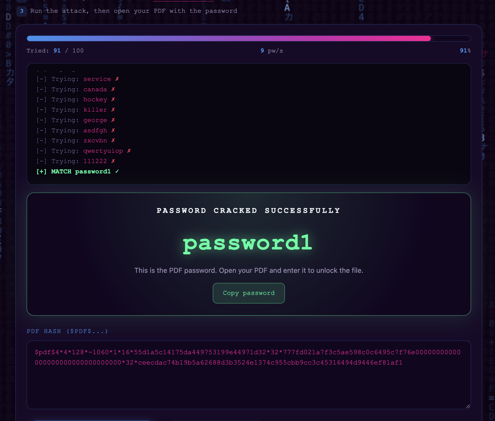
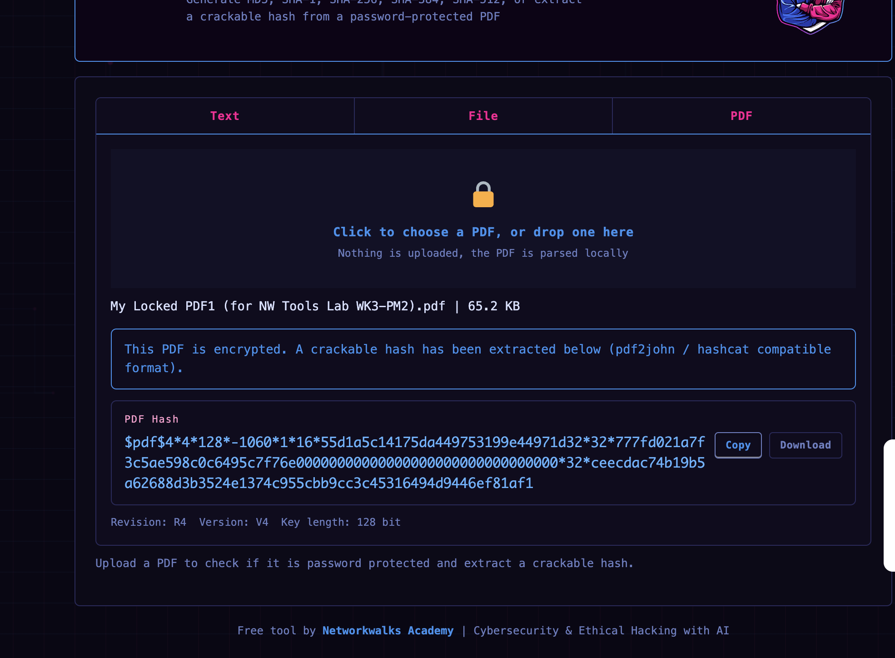
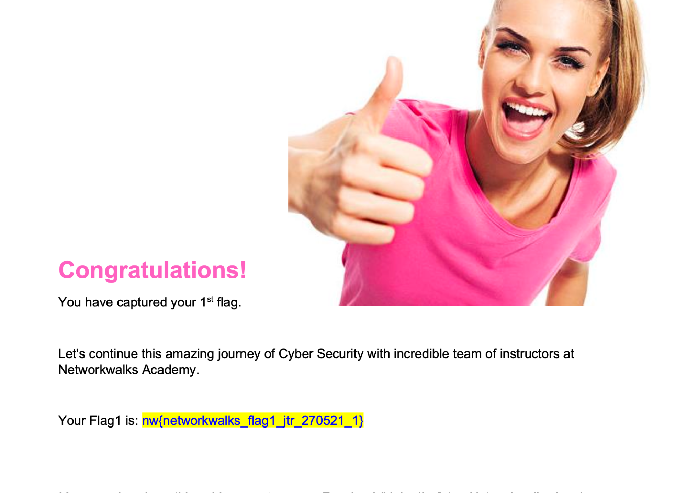

# 🔐 Password Cracking with NetworkWalks Tools

Week 3 · Project Module 2 · NetworkWalks Cybersecurity Internship

## 📌 Project Overview

This lab demonstrates password recovery of a locked PDF using two free, browser-based tools built by NetworkWalks: the Hash Calculator (extracts a crackable hash, in pdf2john/hashcat-compatible format, from a password-protected PDF) and the Password Cracker (runs a dictionary attack against that hash using a built-in wordlist). Both tools run entirely client-side in the browser, so no installation or VM was needed — this was done directly on macOS (Apple Silicon, host from the author's existing lab setup) in a web browser.

- **Target file:** `My Locked PDF1 (for NW Tools Lab WK3-PM2).pdf` (a password-protected PDF provided by the course for this exercise)
- **Tools used:** [NetworkWalks Hash Calculator](https://networkwalks.com/hash-calculator/) and [NetworkWalks Password Cracker](https://networkwalks.com/password-cracker/)

## 🎯 Objectives

- Extract a crackable hash from a password-protected PDF using the NetworkWalks Hash Calculator
- Run a dictionary attack against the hash using the NetworkWalks Password Cracker
- Recover the password and unlock the PDF to capture the flag

## 🪜 Solution

1. Opened the NetworkWalks Hash Calculator in the browser and uploaded the locked PDF via its "PDF" tab.
2. The tool parsed the PDF locally (nothing uploaded to a server) and extracted a crackable hash in pdf2john/hashcat format, starting with `$pdf$4*4*128*...` (PDF revision 4, 128-bit key length).
3. Copied the full hash value.
4. Opened the NetworkWalks Password Cracker and pasted the hash into the PDF HASH field.
5. Ran the attack using the tool's built-in 100-word dictionary list by clicking "Start Cracking".
6. The tool tried candidate passwords (service, canada, hockey, killer, george, asdfgh, zxcvbn, qwertyuiop, 111222, etc.) and found a match after 91 of 100 attempts.
7. Cracked password: `password1`
8. Opened the locked PDF and entered `password1` to unlock it, confirming the file opened successfully and displayed a "Congratulations — you captured your 1st flag" page.
9. Captured flag: `nw{networkwalks_flag1_jtr_270521_1}`

## 📸 Screenshots

## 💡 What I Learned

- How PDF password hashes are structured and extracted (pdf2john/hashcat-compatible `$pdf$...` format).
- Why a weak dictionary-guessable password like `password1` is cracked almost instantly.
- The value of browser-based/client-side tools for safely learning password auditing without installing anything.
- How this complements the John the Ripper CLI/GUI approach used in the parallel Module 1 lab.

## 🔐 Security & Ethical Use

This lab is for education only, performed only on a file provided for this course exercise. No real production systems or credentials were targeted.

## 🔗 Tools & Resources

| Tool | URL |
| ---- | --- |
| NetworkWalks Hash Calculator | https://networkwalks.com/hash-calculator/ |
| NetworkWalks Password Cracker | https://networkwalks.com/password-cracker/ |

## 👤 Author

**Morgan White**, Cybersecurity Professional B084

LinkedIn: https://www.linkedin.com/in/morgan-white-26059a205

## 📌 Project Information

NetworkWalks Cybersecurity Program · Week 03 · Password Cracking with NetworkWalks Tools
